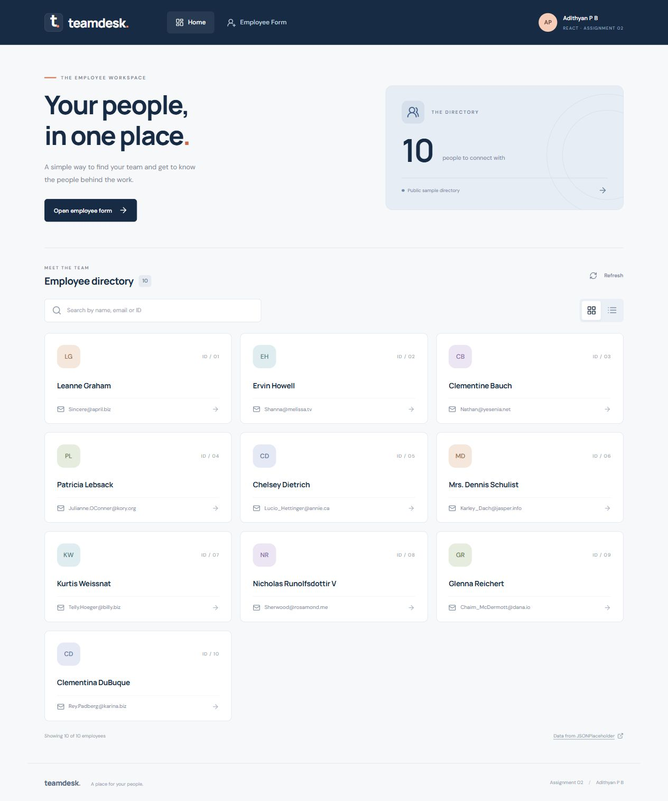

# Teamdesk — Employee Dashboard

**Assignment 2**

**Student: Adithyan P B**

A React employee dashboard built from scratch with a card directory, an alternative table view, and a separate employee form. Uses **React Router**, **Bootstrap 5**, **Vite**, and **Lucide React**.

**GitHub submission:** https://github.com/adityn09/employee-dashboard



## Run the project

Install Node.js 22.12 or later. From this project folder:

```sh
npm ci
npm run dev
```

Open the URL printed by Vite. For a production build:

```sh
npm run build
npm run preview
```

## Assignment requirements

| Requirement | Implementation |
| --- | --- |
| React library | Functional React components and hooks |
| Navbar with Home and Employee Form links | Shared navbar with active link styling |
| Home / Employee Dashboard | `/#/` |
| External API | GET https://jsonplaceholder.typicode.com/users |
| Display ID, name and email | Employee cards or table view |
| Employee Form | `/#/employee-form` |
| Required fields | Name, Designation, Location and Salary |
| CSS library | Bootstrap 5, installed through npm |
| No data posting needed | Form only previews values in React state; no POST requests |

HashRouter allows route navigation and page refreshes on static hosts without server rewrite rules. The form is frontend-only: no data is stored, posted, or added to the directory. Navigating away clears the form. The API users are public sample data, shown as employees for the assignment.

## Features

- Search by name, email or employee ID.
- Switch between card and table layouts.
- API loading indicator, timeout, retry action, refresh and empty states.
- Required form fields; whitespace-only text and negative salary are rejected.
- Salary is interpreted as a monthly amount in INR, with up to two decimal places.
- Preview valid employee details and reset the form.
- Keyboard navigation, labelled inputs, route focus management and a skip link.
- Responsive Bootstrap grid and custom CSS.

Internet access is needed for the API. Google Fonts is optional; the interface has fallback fonts.

## Project structure

```text
public/favicon.svg
src/
  main.jsx                  App entry and Bootstrap import
  App.jsx                   Shared layout and routes
  styles.css                Custom responsive design
  components/Avatar.jsx     Employee initials
  pages/Dashboard.jsx       API fetch, cards, table and search
  pages/EmployeeForm.jsx    Form validation and local preview
```

## Manual checks

See [verification results](docs/VERIFICATION.md) and the [employee form preview](docs/employee-form.png).

1. Confirm Home shows the live users with IDs, names and emails.
2. Search for a name, email and ID. Try an unmatched search and clear it.
3. Switch between the card and table views.
4. Open Employee Form; try empty fields, whitespace-only text and a negative salary.
5. Enter valid details and choose **Preview details**. Confirm all values are displayed.
6. Edit a field to dismiss the old preview. Use **Reset form** to clear the values.
7. Navigate using Home and Employee Form; refresh both routes.
8. Check the layout on a phone; scroll the table horizontally if needed.
9. Check the error and retry state when the external API is unavailable.

## References

- [JSONPlaceholder users API](https://jsonplaceholder.typicode.com/users)
- [React Router documentation](https://reactrouter.com/start/declarative/installation)
- [Bootstrap documentation](https://getbootstrap.com/docs/5.3/getting-started/introduction/)

Submit this project's GitHub repository link for Assignment 2.
